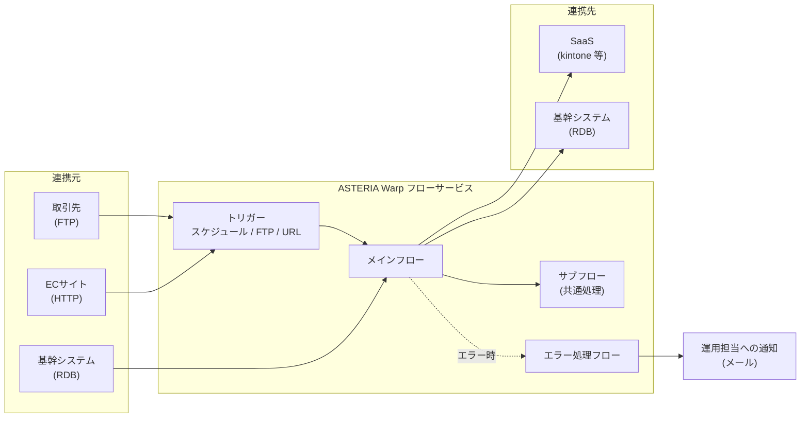

# ASTERIA Warp 結合テスト計画書

| 項目 | 内容 |
| --- | --- |
| 文書番号 | 【要記入】 |
| システム名 | 【要記入】 |
| 版数 | 1.0 |
| 作成日 | 2026-10-23 |
| 作成者 | 【要記入】 |
| 承認者 | 【要記入】 |

> **本書の使い方**
> 本書は ASTERIA Warp で構築したデータ連携システム向けの結合テスト計画書のひな形です。
> 【要記入】【要設定】の箇所と「（記入例）」の値をプロジェクトに合わせて置き換えてください。
> トリガーの種類やチェックポイント機能など、使える機能はエディション・バージョンで異なります。対象環境の製品マニュアルで確認したうえで確定してください。

## 改訂履歴

| 版数 | 日付 | 改訂内容 | 作成者 | 承認者 |
| --- | --- | --- | --- | --- |
| 1.0 | 2026-10-23 | 初版作成 | 【要記入】 | 【要記入】 |

---

## 1. はじめに

### 1.1 目的

本書は、【システム名】で ASTERIA Warp により実装したデータ連携処理（フロー）の結合テストについて、対象範囲・方針・環境・体制・スケジュール・開始／終了基準を定め、関係者間で合意することを目的とする。

### 1.2 適用範囲

本書は結合テスト工程（内部結合テスト IT1／外部結合テスト IT2）に適用する。単体テスト・総合テスト・受入テストは対象外とし、それぞれの計画書で定める。

### 1.3 参照文書

| No | 文書名 | 版数 | 備考 |
| --- | --- | --- | --- |
| 1 | 要件定義書 | 【要記入】 | |
| 2 | 基本設計書（インターフェース一覧・連携方式設計） | 【要記入】 | |
| 3 | 詳細設計書（フロー設計書・マッピング定義書・エラー処理設計） | 【要記入】 | |
| 4 | 連携先システム インターフェース仕様書 | 【要記入】 | 連携先ごと |
| 5 | 単体テスト完了報告書 | 【要記入】 | 開始基準の確認に使用 |
| 6 | 運用設計書（監視・通知・再実行手順） | 【要記入】 | |
| 7 | ASTERIA Warp 製品マニュアル | 対象バージョン | |

### 1.4 用語定義

| 用語 | 説明 |
| --- | --- |
| フロー | ASTERIA Warp で、コンポーネントを組み合わせて処理手順を定義したもの |
| メインフロー／サブフロー | トリガー等から起動される起点のフロー／SubFlow コンポーネントから呼び出されるフロー |
| エラー処理フロー | コンポーネントやフローでエラーが発生したときに、エラー処理プロパティの設定で呼び出される後処理用のフロー |
| コンポーネント | フローを構成する処理部品（FileGet、RDBPut、Mapper など） |
| ストリーム | コンポーネント間で受け渡されるデータ |
| フロー変数 | フロー実行中に値を保持する変数 |
| コネクション | DB・FTP・SaaS などの接続先情報をフローサービスに登録したもの |
| 外部変数 | フロー外部で定義して参照する設定値。環境依存値の管理にも使う |
| トリガー／実行設定 | フローを自動起動する仕組み／フローとトリガーを関連付ける設定 |
| フローサービス | フローを実行するサーバー（実行エンジン） |
| フローデザイナー | フローの開発ツール |
| 管理コンソール | フローサービスの管理画面（トリガー、コネクション、ユーザー、ログなどを管理） |
| IF | インターフェース。連携元から連携先への 1 つのデータ連携の単位 |
| IT1（内部結合テスト） | ASTERIA Warp 内でのフロー同士、およびトリガーとフローの結合を検証するテスト |
| IT2（外部結合テスト） | ASTERIA Warp と連携先システム（テスト環境の実機）をつないで検証するテスト |

---

## 2. テスト対象

### 2.1 システム概要（記入例）

### 2.2 テスト対象インターフェース一覧

| IF-ID | IF 名 | 連携元 | 連携先 | 方式 | 起動方法 | 頻度 | 件数（通常／最大） | 対象フロー | IT1 | IT2 |
| --- | --- | --- | --- | --- | --- | --- | --- | --- | --- | --- |
| IF-001 | 受注データ連携（記入例） | 基幹 DB | kintone | DB → REST API | スケジュールトリガー | 毎時 | 500／5,000 | 【要記入】 | ○ | ○ |
| IF-002 | 取引先マスタ取込（記入例） | 取引先 | 基幹 DB | CSV → DB | FTP トリガー | 随時 | 100／10,000 | 【要記入】 | ○ | ○ |
| IF-003 | 在庫照会（記入例） | EC サイト | 基幹 DB | HTTP 同期応答 | URL トリガー | 随時 | 1 件／リクエスト | 【要記入】 | ○ | ○ |
| IF-004 | 夜間一括連携（記入例） | 基幹 DB | ファイルサーバー | DB → CSV | 外部コマンド起動（ジョブ管理ツール） | 日次 | 50,000／200,000 | 【要記入】 | ○ | ○ |

### 2.3 テスト対象外

- 単体テストで確認済みのフロー内部ロジック（項目ごとの変換など）の網羅的な再確認。ただし結合の観点で必要なものは対象とする
- 連携先システム内部の業務処理の正しさ（連携先チームの責任範囲）
- 本格的な性能・負荷・長時間稼働テスト、クラスタ構成でのフェイルオーバーテスト（総合テストで実施）
- ASTERIA Warp 製品そのものの機能保証
- 【要記入】

### 2.4 テスト工程の位置づけ

| 工程 | 主な検証内容 | 環境 | 外部接続 |
| --- | --- | --- | --- |
| 単体テスト（UT） | フロー単体のロジック、マッピング、分岐、コンポーネントの入出力 | 開発環境 | スタブ／ローカルファイル |
| **内部結合テスト（IT1）** | メインフロー⇔サブフロー⇔エラー処理フロー、トリガー起動、パラメータ・フロー変数・ストリームの受け渡し | 結合テスト環境 | スタブ／テスト用 DB |
| **外部結合テスト（IT2）** | 連携先実機との接続・認証・データの受け渡し、件数の整合、異常時の挙動と復旧 | 結合テスト環境 | 連携先テスト環境 |
| 総合テスト（ST） | 業務シナリオ、性能、運用・障害対応 | 本番相当環境 | 本番相当 |

---

## 3. テスト方針

### 3.1 基本方針

1. IF 単位でテストケースを作り、すべての IF で正常系・異常系・境界値を検証する。
2. IT1 → IT2 の順に段階的に進める。IT2 は連携先の準備が整った IF から順に着手する。
3. 全 IF で件数の整合（**入力件数 ＝ 正常出力件数 ＋ エラー件数 ＋ スキップ件数**）を確認する。
4. 合否は連携元と連携先の実データを突き合わせて判定する。ASTERIA Warp のログだけで合格としない。
5. 異常系は「検知」「停止／継続の制御」「通知」「ログ」「復旧（再実行）」の 5 点をセットで確認する。
6. ノーコード開発では差分が見えにくいため、どの版のプロジェクト／フローでテストしたかを毎回記録する。
7. 再実行しても二重登録や欠落が起きないこと（冪等性）を、異常系の必須確認項目とする。

### 3.2 テスト観点

#### A. フロー間連携

| ID | 観点 | 確認内容 | IT1 | IT2 |
| --- | --- | --- | --- | --- |
| A-01 | サブフロー呼び出し | 入出力パラメータの受け渡し。型・NULL・空文字の扱い | ○ | |
| A-02 | フロー変数 | 初期化のタイミング。ループ内で同じ SubFlow コンポーネントから繰り返し呼び出したとき、前回の値が残らないこと（サブフロー側でフロー先頭に明示的な初期化があるか） | ○ | |
| A-03 | ストリーム | フロー間でストリーム形式（Record／XML／CSV／Text など）、文字コード、レコード構造が合っていること | ○ | |
| A-04 | フロー連鎖 | 先行 IF の出力（ファイル／テーブル）を後続 IF が正しく取り込むこと。実行順序 | ○ | ○ |
| A-05 | 共通部品 | 共通サブフローや共通関数を複数 IF から使ったときの挙動 | ○ | |

#### B. 起動（トリガー・実行設定）

| ID | 観点 | 確認内容 | IT1 | IT2 |
| --- | --- | --- | --- | --- |
| B-01 | スケジュールトリガー | 指定日時・間隔での起動。営業日カレンダーによる休日スキップ。月末・年末・日付をまたぐ実行 | ○ | |
| B-02 | FTP トリガー | 指定フォルダーへのアップロードで起動すること。ファイル名、複数ファイルの同時受信、処理後のファイルの扱い | ○ | ○ |
| B-03 | URL トリガー（HTTP 起動） | リクエストパラメータ、認証、レスポンス（ステータスコード・本文）、タイムアウト | ○ | ○ |
| B-04 | メール／メッセージキュートリガー | ポーリング間隔、メッセージの削除タイミング、条件に合わないメッセージの扱い（使用する場合） | ○ | ○ |
| B-05 | 外部コマンド起動 | ジョブ管理ツールから起動したとき、フローの成否が終了コードとして正しく判定されること | ○ | ○ |
| B-06 | 多重起動 | 前回の実行中に次の起動条件が成立しても、二重処理やデータ競合が起きないこと | ○ | ○ |
| B-07 | 停止中の事象 | トリガー停止中に届いたファイルや過ぎたスケジュールが、設計どおりに扱われること | ○ | |

> 監視フォルダーにファイルが置かれたら処理する、といった要件を FileList コンポーネント＋スケジュールトリガーで実装している場合は、B-01 と B-02 の両方の観点（書き込み途中のファイルを拾わないこと、処理済みファイルの移動・削除）で確認する。

#### C. 外部接続

| ID | 観点 | 確認内容 | IT1 | IT2 |
| --- | --- | --- | --- | --- |
| C-01 | 接続・認証 | コネクション設定（接続先、認証情報、証明書）で接続できること | | ○ |
| C-02 | RDB | 参照・登録・更新・削除。コミット／ロールバック。ロック競合 | ○ | ○ |
| C-03 | ファイル／FTP／SFTP | パス、権限、文字コード、改行コード。同名ファイルがあるときの上書き／追記／エラー | ○ | ○ |
| C-04 | REST API・SaaS | ページング、API 呼び出し上限（レート制限）、トークン期限切れ、HTTP 4xx／5xx | | ○ |
| C-05 | メール送信 | 宛先、件名、本文、添付ファイル、文字化け | ○ | ○ |
| C-06 | タイムアウト・リトライ | 接続／応答タイムアウト値、リトライ回数・間隔が設計どおりであること | | ○ |

#### D. データ変換（マッピング）

| ID | 観点 | 確認内容 | IT1 | IT2 |
| --- | --- | --- | --- | --- |
| D-01 | 文字コード | UTF-8 と MS932（Shift_JIS）の相互変換。機種依存文字、外字、サロゲートペア、半角カナ（4.4 の特殊文字データセットを使う） | ○ | ○ |
| D-02 | データ型・桁 | 数値の桁あふれ、小数の精度・丸め、文字列長（バイト長と文字数の違い）、先頭ゼロ | ○ | ○ |
| D-03 | 日付・時刻 | 書式、タイムゾーン（SaaS API の UTC と JST）、うるう年、月末 | ○ | ○ |
| D-04 | NULL・空文字・空白 | DB の NULL、CSV の空項目、JSON の null／項目なし の相互の扱い。前後空白のトリム | ○ | ○ |
| D-05 | CSV・固定長 | 区切り文字、囲み文字、項目内の改行・カンマ・ダブルクォート、ヘッダーの有無、BOM、最終行の改行 | ○ | ○ |
| D-06 | コード変換 | 変換表（マスタ）にない値の扱い | ○ | ○ |

#### E. 業務・件数

| ID | 観点 | 確認内容 | IT1 | IT2 |
| --- | --- | --- | --- | --- |
| E-01 | 件数の整合 | 入力件数 ＝ 正常出力 ＋ エラー ＋ スキップ。ログの件数と実データの件数が一致すること | ○ | ○ |
| E-02 | データ量 | 0 件、1 件、通常件数、想定最大件数。処理時間は参考値として記録する | ○ | ○ |
| E-03 | 差分／全件連携 | 差分の抽出条件（更新日時、連携済みフラグ）。連携済みフラグの更新 | ○ | ○ |
| E-04 | データのライフサイクル | 登録 → 更新 → 削除（論理削除）の一連が連携先に正しく反映されること | | ○ |

#### F. 異常系・復旧

| ID | 観点 | 確認内容 | IT1 | IT2 |
| --- | --- | --- | --- | --- |
| F-01 | 接続異常 | 連携先の停止、ネットワーク断、認証失敗、証明書の期限切れ | | ○ |
| F-02 | データ異常 | 必須項目の欠落、型不正、桁超過、キー重複、フォーマット不正のファイル、0 バイトのファイル | ○ | ○ |
| F-03 | エラー処理プロパティ | コンポーネント／フローのエラー処理（エラーを無視する／フローを終了する／リクエストを終了する／エラー処理フローを呼び出す）が設計どおりに動くこと。エラー処理フローにエラー情報（エラーコード、メッセージ、対象データ）が渡ること | ○ | ○ |
| F-04 | 業務エラー | Exception コンポーネントで発生させた業務エラーが、呼び出し元とエラー処理フローに設計どおり伝わること。ExceptionReturn で復帰する場合はその後の処理 | ○ | |
| F-05 | 途中異常時の整合性 | 処理の途中で異常終了したとき、DB のロールバック範囲（エラー処理フローは呼び出し元のトランザクション状態を引き継ぐ点に注意）、出力済みファイルや連携済みデータの扱い | ○ | ○ |
| F-06 | 再実行（復旧） | 原因を取り除いて再実行したとき、二重登録や欠落が起きないこと。チェックポイント機能を使う場合は、チェックポイントからの再実行（エディションにより利用可否が異なる） | ○ | ○ |

#### G. 運用・監視

| ID | 観点 | 確認内容 | IT1 | IT2 |
| --- | --- | --- | --- | --- |
| G-01 | ログ | 実行結果（開始・終了、件数、エラー内容）が設計どおり出力され、管理コンソールなどで追跡できること | ○ | ○ |
| G-02 | 通知 | 異常時の通知（メールなど）が設計どおりの宛先・内容で送られること。正常時に誤って通知しないこと | ○ | ○ |
| G-03 | 機密情報 | ログ、通知、エラーメッセージにパスワード、トークン、個人情報が平文で出ないこと | ○ | ○ |
| G-04 | 運用手順 | 手動実行、再実行、トリガーの停止・再開が運用手順書どおりにできること | | ○ |

#### H. 環境依存

| ID | 観点 | 確認内容 | IT1 | IT2 |
| --- | --- | --- | --- | --- |
| H-01 | 環境依存の設定 | コネクション、外部変数、ファイルパスが結合テスト環境の値になっており、開発環境や本番環境を参照していないこと | ○ | ○ |
| H-02 | 実行ユーザーの権限 | フローサービスの実行ユーザーが、必要なファイル・フォルダー・DB オブジェクトにアクセスできること（権限が過剰でないこと） | ○ | ○ |
| H-03 | 時刻 | フローサービスと連携先の時刻が同期していること（差分抽出やスケジュールの基準時刻） | | ○ |

### 3.3 テスト技法

| 技法 | 主な適用先 |
| --- | --- |
| 同値分割・境界値分析 | 桁数、件数、日付、数値の範囲 |
| デシジョンテーブル | フロー内の分岐条件の組み合わせ、エラー処理の分岐 |
| 状態遷移 | 連携済みフラグ・ステータス項目、再実行時の状態 |
| エラー推測 | 連携でよく起きる不具合（文字化け、NULL、タイムゾーン、桁あふれ、CSV 崩れ） |
| データ突合 | 連携元と連携先のデータを SQL や比較ツールで全件比較 |

### 3.4 テストケースの記載ルール

- 1 ケースにつき確認する期待結果は 1 つとする。
- 期待結果には、どこ（管理コンソール、DB、ファイル、連携先画面、ログ）で何を確認するかまで書く。
- テストケース ID は `IT{1|2}-{IF-ID}-{3 桁の連番}` とする（例：`IT2-IF001-005`）。
- エビデンスは `{テストケース ID}_{連番}.{拡張子}` の名前で【保存先：要記入】に保存する。管理コンソールの実行結果、DB の検索結果、出力ファイル、連携先画面のキャプチャなどを対象とする。

---

## 4. テスト環境

### 4.1 環境構成

| 区分 | 項目 | 内容 |
| --- | --- | --- |
| ASTERIA Warp | エディション／バージョン | 【要記入】 |
| | フローサービスのサーバー | ホスト名・OS・CPU／メモリ 【要記入】 |
| | 構成 | シングル／クラスタ 【要記入】 |
| | フローデザイナー | 開発端末 【要記入】 |
| 連携先 | 基幹 DB（テスト環境） | 【要記入】 |
| | SaaS（サンドボックス／テスト用テナント） | 【要記入】 |
| | FTP／SFTP サーバー | 【要記入】 |
| | メールサーバー | テスト用。実在の宛先へ誤送信しないよう、送信先をテスト用のメールボックスに限定する |
| 補助ツール | DB クライアント、ファイル比較ツール、API クライアント、テスト管理ツール | 【要記入】 |

> 本番環境との差異（エディション、クラスタ構成、ネットワーク経路、プロキシ、証明書など）は一覧にまとめ、差異部分は総合テストで確認する。

### 4.2 ASTERIA Warp 環境の準備

1. **テスト対象のデプロイ**：テスト対象のプロジェクトを結合テスト環境に配置し、版（プロジェクト名、更新日時、エクスポートファイルのハッシュ値など）を記録する。
2. **環境依存の設定**：コネクションと外部変数を結合テスト環境向けに設定し、設定値の一覧をエビデンスとして残す。
3. **トリガー・実行設定**：トリガーと実行設定を登録する。意図しない自動実行でテスト結果が汚れないよう、原則として該当ケースの実施時だけ有効にする。
4. **ユーザー・権限**：管理コンソールとフローデザイナーのユーザーおよび権限を設定する。
5. **ログ設定**：調査しやすい出力レベルに設定する。本番設定との違いは記録しておく。
6. **時刻同期**：フローサービスのサーバーと連携先の時刻が同期していることを確認する。

### 4.3 スタブ・モック

連携先の準備が整っていない場合（主に IT1）は、次の方法で代替する。スタブで実施したケースは、IT2 で実機を使って再確認する。

| 連携先の種別 | 代替方法 |
| --- | --- |
| REST API | URL トリガーで固定のレスポンスを返すスタブフローを ASTERIA Warp 上に作る、またはモックサーバーを使う |
| RDB | 連携先と同じ定義のテスト用スキーマを用意する |
| ファイル連携 | テスト用フォルダーにダミーファイルを置く |
| メール | テスト用のメールサーバー／メールボックスを使う |

### 4.4 テストデータ

- **作成方針**：原則として本番データは使わない。やむを得ず使う場合は個人情報などをマスキングし、【情報管理責任者】の承認を得る。
- **用意するパターン**：正常値、境界値、異常値、特殊文字（下表）、大量件数。
- **初期化**：テストケースの実施前に、連携元・連携先のデータを既知の状態に戻す手順（スクリプト）を用意する。
- **他チームとの干渉防止**：連携先と共用する環境では、使うキー値の範囲や時間帯を事前に取り決める。

#### 特殊文字データセット（D-01 用）

| 区分 | 例 | 確認ポイント |
| --- | --- | --- |
| 機種依存文字 | ①　Ⅲ　㈱　髙　﨑 | MS932 と UTF-8 の変換で化けないこと。変換できない場合の扱い |
| 変換差異のある文字 | 〜（U+301C）と ～（U+FF5E）、−（U+2212）と －（U+FF0D）、‖ と ∥、¢ £ ¬ と ￠ ￡ ￢ | Shift_JIS／MS932／UTF-8 の間でマッピングが異なる文字 |
| サロゲートペア | 𠮷　𩸽 | 文字数・バイト数の数え方、連携先が対応しているか |
| 半角カナ | ｱｲｳ　ﾊﾟﾋﾟ | 全角への変換の有無、桁数 |
| 制御文字・記号 | 改行（CR／LF／CRLF）、タブ、カンマ、ダブルクォート | CSV の崩れ、項目内の改行 |
| 空白 | 全角スペース、前後の空白 | トリムの有無 |

---

## 5. 開始基準・終了基準・中断／再開基準

### 5.1 開始基準

- 対象フローの単体テストが完了し、単体テスト完了報告書が承認されていること。
- 単体テストの未解決不具合が 0 件であること。残っている場合は、結合テストに影響しないと判断され承認されていること。
- 結合テスト仕様書（テストケース）がレビュー済みで、承認されていること。
- 結合テスト環境、テストデータ、スタブの準備が終わり、疎通確認が済んでいること。
- （IT2）連携先のテスト環境が使え、連携先担当者の立ち会いまたは問い合わせ窓口が確保されていること。

### 5.2 終了基準

- 計画したテストケースをすべて実施していること（消化率 100%）。
- 全ケースが合格していること。不合格のケースは不具合を修正して再テストし、合格していること。保留のケースは理由と対応方針が承認されていること。
- 重大度 S・A の未解決不具合が 0 件であること。
- 重大度 B・C の未解決不具合は、対応方針（次工程で対応するなど）が承認されていること。
- 品質指標（6 章）が目標範囲内であること。範囲外の場合は、原因の分析と追加対策が済んでいること。
- 不具合の検出数が収束していること（信頼度成長曲線が収束している）。
- 結合テスト完了報告書が承認されていること。

### 5.3 中断・再開基準

**中断基準**

- 重大度 S の不具合が見つかり、テストを続けられない場合。
- 結合テスト環境または連携先環境の障害が【要設定：例 4 時間】以上続く場合。
- 同じ IF で不具合が【要設定】件以上見つかり、品質不足が疑われる場合（単体テストへの差し戻しを検討する）。

**再開基準**

- 中断の原因が解消し、テストリーダーが再開を承認したとき。必要に応じて、影響を受けたケースを再実施する。

---

## 6. 品質目標と評価方法

ASTERIA Warp はノーコード開発のため、ステップ数（KLOC）ではなくフロー数・コンポーネント数・IF 数を規模の指標とする。

| 指標 | 算出式 | 目標値 |
| --- | --- | --- |
| テスト密度 | テストケース数 ÷ 規模（フロー数またはコンポーネント数） | 【要設定】（プロジェクト標準または過去実績から設定） |
| 不具合密度 | 不具合件数 ÷ 規模 | 【要設定】（上限・下限を設定） |
| 観点網羅率 | 実施した観点数 ÷ 3.2 のうち該当する観点数 | 100% |
| IF 網羅率 | テストした IF 数 ÷ 対象 IF 数 | 100% |
| 異常系の比率 | 異常系のケース数 ÷ 全ケース数 | 【要設定】% 以上 |

**評価の考え方**

- 不具合密度が上限を超えた場合は品質不足、下限を下回った場合はテスト不足の可能性があるとみて原因を分析する。
- 不具合は原因区分（9.2）ごとに集計し、同じ種類の不具合がほかの IF にないかを横展開して確認する。

---

## 7. 実施体制

| 役割 | 担当者 | 責任 |
| --- | --- | --- |
| テスト責任者 | 【要記入】 | 計画の承認、終了判定 |
| テストリーダー | 【要記入】 | 進捗・品質・課題の管理、日次報告 |
| テスト担当者 | 【要記入】 | ケースの作成と実施、エビデンスの取得、不具合の起票 |
| ASTERIA Warp 開発担当 | 【要記入】 | 不具合の調査・修正、修正版の提供 |
| ASTERIA Warp 環境管理者 | 【要記入】 | フローサービス、コネクション、トリガー、デプロイの管理 |
| 連携先システム担当 | 【要記入】 | 連携先環境の提供、データ確認、問い合わせ対応 |
| 業務担当 | 【要記入】 | 業務観点での期待値の確認 |

**会議体**

| 会議 | 頻度 | 参加者 | 内容 |
| --- | --- | --- | --- |
| 朝会 | 毎日 | テストリーダー、テスト担当者、開発担当 | 進捗、当日の予定、課題 |
| 進捗報告会 | 週次 | テスト責任者、テストリーダー、関係者 | 進捗、品質状況、リスク |
| 連携先との定例 | 週次（IT2 期間） | テストリーダー、連携先担当 | 日程、環境、データ、不具合の調整 |

---

## 8. スケジュール

| フェーズ | 作業 | 期間 | 成果物 |
| --- | --- | --- | --- |
| 準備 | テストケースの作成・レビュー | 【W1〜W2】 | 結合テスト仕様書 |
| 準備 | 環境構築、テストデータ・スタブの作成、疎通確認 | 【W2】 | 環境設定一覧、テストデータ |
| 実施 | 内部結合テスト（IT1） | 【W3】 | テスト結果、エビデンス |
| 実施 | 外部結合テスト（IT2） | 【W4〜W5】 | テスト結果、エビデンス |
| 実施 | 回帰テスト（修正の確認） | 【W5〜W6】 | テスト結果、エビデンス |
| 評価 | 品質評価、完了報告 | 【W6】 | 結合テスト完了報告書 |

**連携先と事前に調整すること**：接続する日時、テスト環境を使える時間帯、データの初期化タイミング、立ち会いの要否、障害時の連絡先。

---

## 9. 不具合管理

### 9.1 重大度の定義

| 重大度 | 定義 | 例 |
| --- | --- | --- |
| S（致命的） | 連携が止まる、データの破損・消失・二重登録が起きる | 全件がエラーになる、ロールバックされず不整合が残る |
| A（重大） | 一部のデータが誤って連携される、異常を検知・通知できない | 特定の条件で項目値が欠落する、エラー時に通知されない |
| B（軽微） | 業務への影響が小さい | ログの文言の誤り |
| C（改善） | 仕様どおりだが改善が望ましい | ログの出力項目の追加 |

### 9.2 管理の流れ

- **管理ツール**：【要記入】
- **記載項目**：不具合 ID、テストケース ID、事象、再現手順、期待結果、実際の結果、重大度、原因区分、対象フロー／コンポーネント、修正版、修正者、確認者
- **原因区分**：設計誤り／フロー実装誤り（マッピング、分岐、エラー処理設定）／環境設定誤り（コネクション、外部変数、トリガー）／連携先起因／テストケース誤り／仕様変更
- **回帰テスト**：修正したフローを使う IF の影響範囲を再テストする。共通サブフローを修正した場合は、それを使うすべての IF を対象とする。

### 9.3 構成管理

- 修正版をデプロイするタイミングを決めておき、テスト実施中にフローを無断で更新しない。
- デプロイのたびに版、変更内容、影響する IF を記録し、テストリーダーの承認を得る。

---

## 10. 成果物

| 成果物 | 内容 | 作成者 | 承認者 |
| --- | --- | --- | --- |
| 結合テスト計画書 | 本書 | テストリーダー | テスト責任者 |
| 結合テスト仕様書 | テストケース一覧 | テスト担当者 | テストリーダー |
| テストデータ一式 | テストデータ、初期化スクリプト | テスト担当者 | テストリーダー |
| テスト結果・エビデンス | 実施結果、キャプチャ、出力ファイル | テスト担当者 | テストリーダー |
| 不具合管理表 | 不具合の一覧と対応状況 | テストリーダー | テスト責任者 |
| 進捗報告書 | 日次／週次の進捗・品質状況 | テストリーダー | テスト責任者 |
| 結合テスト完了報告書 | 実施結果、品質評価、残課題 | テストリーダー | テスト責任者 |

---

## 11. リスクと対策

| リスク | 影響 | 対策 |
| --- | --- | --- |
| 連携先テスト環境の準備遅れ・利用制限 | IT2 の着手が遅れる | 利用日程を早めに確保する。IT1 はスタブで先行し、IT2 は優先度の高い IF から順に進める |
| 連携先との仕様の認識違い（項目定義、文字コード、日付形式） | 手戻り | IT2 の前に IF 仕様書の読み合わせを行い、サンプルデータを事前に交換する |
| SaaS の API 呼び出し上限・サンドボックスの制約 | 大量件数のテストができない | 実施回数を計画する。件数のテストは上限内で行い、総合テストで再確認する |
| テスト環境と本番環境の構成差異 | 本番で不具合が表に出る | 差異の一覧を作り、差異部分は総合テストで確認する |
| 環境依存の設定ミス（本番の接続先を参照するなど） | 本番データの破損、誤送信 | 接続先一覧をダブルチェックする。メールの送信先をテスト用に限定する |
| テストデータが他チームのテストと干渉する | テスト結果が不正になる | キー値の範囲と実施時間帯を取り決める |
| トリガーによる想定外の自動実行 | テスト結果が汚れる | トリガーは該当ケースの実施時だけ有効にし、実行履歴で確認する |

---

## 12. 承認

| 役割 | 氏名 | 日付 | 署名 |
| --- | --- | --- | --- |
| テスト責任者 | | | |
| 開発責任者 | | | |
| 連携先システム責任者 | | | |

---

## 付録 A. テストケース記載例

| テストケース ID | 観点 | 前提条件 | 手順 | 期待結果 | 確認方法 |
| --- | --- | --- | --- | --- | --- |
| IT2-IF001-001 | E-01 件数の整合 | 連携元に未連携の受注データ 100 件（正常データ） | 1. スケジュールトリガー（または手動実行）で IF-001 を起動する | 1. kintone に 100 件が登録され、全項目がマッピング定義書どおりである 2. 連携元の連携済みフラグが 100 件更新される 3. ログの件数が「入力 100／出力 100／エラー 0」である | SQL の結果と kintone の CSV エクスポートを比較ツールで突き合わせる。管理コンソールの実行結果 |
| IT1-IF002-008 | D-05 CSV | 項目内に改行・カンマ・ダブルクォートを含む CSV ファイル | 1. 指定フォルダーへ FTP でアップロードする | 項目が分割されず、元の値のまま DB に登録される | DB の検索結果、元ファイルとの比較 |
| IT2-IF001-015 | F-01／F-06 接続異常と再実行 | 連携元に未連携の受注データ 10 件。連携先担当の協力で、kintone のテスト環境に一時的に接続できない状態にする | 1. IF-001 を起動する 2. 実行結果を確認する 3. 接続を復旧する 4. 運用手順書に従って再実行する | 2. エラー処理フローが呼ばれて異常終了し、運用担当に通知メールが届く。連携済みフラグは更新されない 4. 10 件が 1 回だけ登録され（二重登録なし）、連携済みフラグが更新される | 管理コンソールの実行結果、通知メール、連携元 DB のフラグ、kintone の件数 |

## 付録 B. IF ごとのテストケース作成チェックリスト

- [ ] 正常系（通常件数）
- [ ] 0 件（空ファイル、対象データなし）のときの挙動（正常終了とするか、通知するか）
- [ ] 想定最大件数
- [ ] 全項目のマッピング（最大桁、最小桁、NULL）
- [ ] 特殊文字データセット
- [ ] 日付・時刻（タイムゾーン、月末、うるう年）
- [ ] 連携先の停止、認証エラー、タイムアウト
- [ ] データ不正（必須項目の欠落、型不正、キー重複）
- [ ] エラー処理プロパティとエラー処理フローの動作
- [ ] 途中異常時のロールバックと再実行（冪等性）
- [ ] 多重起動
- [ ] エラー通知、ログ、機密情報のマスキング
- [ ] 環境依存の設定（接続先、外部変数、パス）
